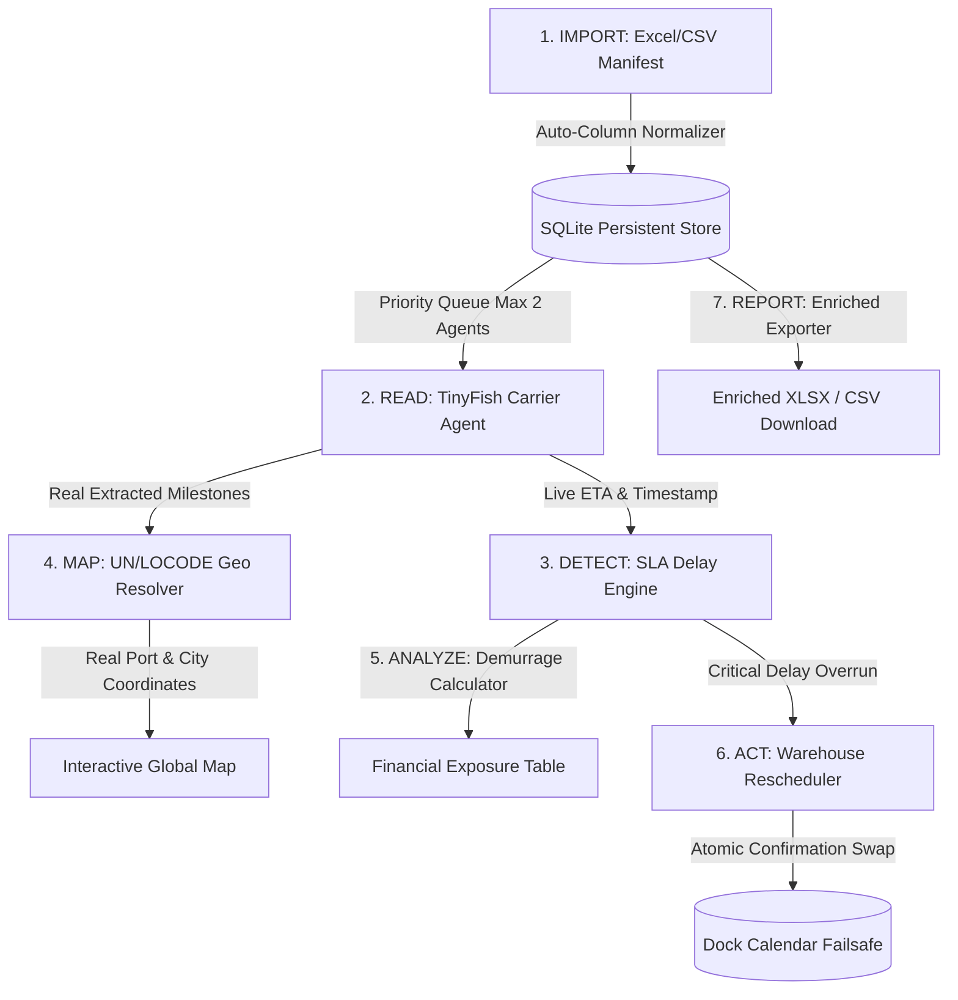

# FREIGHTCOMMAND — Autonomous Freight Intelligence & Logistics Operations

[](https://nextjs.org/)
[](https://react.dev/)
[](https://www.typescriptlang.org/)
[](https://tailwindcss.com/)
[](https://nodejs.org/api/sqlite.html)
[](https://tinyfish.ai)
[](https://leafletjs.com/)
[](https://vitest.dev/)

**FREIGHTCOMMAND** is a full-stack, autonomous freight intelligence command center and logistics execution platform. It transforms static Excel/CSV shipping manifests into real-time operational workflows: live carrier milestone scraping, SLA breach detection, financial demurrage & detention liability calculation, UN/LOCODE geographical coordinate resolution, and autonomous warehouse dock rescheduling with transactional safety failsafes.

---

## Table of Contents

- [Core Value Propositions & Philosophy](#core-value-propositions--philosophy)
- [Operational Pipeline (Data Flow)](#operational-pipeline-data-flow)
- [System Architecture](#system-architecture)
- [Technology Stack](#technology-stack)
- [Project Directory Structure](#project-directory-structure)
- [Key Features](#key-features)
- [API Reference](#api-reference)
- [Quick Start & How to Run](#quick-start--how-to-run)
  - [1. Prerequisites](#1-prerequisites)
  - [2. Clone Repository](#2-clone-repository)
  - [3. Install Dependencies](#3-install-dependencies)
  - [4. Environment Configuration](#4-environment-configuration)
  - [5. Run Development Server](#5-run-development-server)
  - [6. Verification & Automated Tests](#6-verification--automated-tests)
- [Testing & Quality Assurance](#testing--quality-assurance)
- [Autonomous Rescheduling Safety Failsafe](#autonomous-rescheduling-safety-failsafe)
- [Carrier Registry & Integrations](#carrier-registry--integrations)

---

## Core Value Propositions & Philosophy

1. **Ground Truth Over Simulation**:
   FREIGHTCOMMAND adheres strictly to evidence-based logistics. It **never fabricates GPS coordinates**, never generates synthetic carrier tracking events, and never simulates fake warehouse confirmations. If a carrier portal restricts access or requires authentication, the system logs the exact reason and preserves official source URLs for human review.
2. **Strict Concurrency Protection (Max 2 Agents)**:
   All browser agent tasks are dispatched through an instance-wide singleton priority queue that enforces a **strict maximum ceiling of 2 concurrent TinyFish agent runs** across the application.
3. **Failsafe Autonomous Rescheduling**:
   When delayed vessels cause missed warehouse delivery windows, an autonomous rescheduling agent negotiates a replacement dock reservation. The platform enforces an atomic guardrail: **the existing warehouse booking is NEVER released or marked rescheduled until a valid replacement booking with a unique confirmation ID (`WH-CONF-...`) is successfully booked**.
4. **Zero-Dependency Native Persistence**:
   Local persistence is powered by Node.js 24's built-in `node:sqlite` (`DatabaseSync`) configured in WAL mode with connection busy timeouts (`PRAGMA busy_timeout = 5000;`). No external database servers or native C++ compilation modules are required.

---

## Operational Pipeline (Data Flow)

The platform runs the closed-loop **`IMPORT → READ → DETECT → MAP → ANALYZE → ACT → REPORT`** operations lifecycle:



1. **IMPORT**: The operations manager uploads an ocean/land shipping manifest in `.xlsx`, `.xls`, or `.csv` format via drag-and-drop. Column headers (`Container ID`, `Carrier`, `Destination`, `Promised Delivery`, etc.) are auto-detected and normalized.
2. **READ**: The server enqueues tracking tasks into a concurrency-limited queue (max 2 parallel). TinyFish web agents navigate official carrier tracking pages (Maersk, MSC, CMA CGM, Hapag-Lloyd, COSCO, LDB India, BlueDart, Delhivery, etc.) to extract verifiable status milestones and timestamps.
3. **DETECT**: The SLA detection engine compares the carrier's live revised ETA against the promised delivery date. Delays >24h are flagged as breaches, delays >72h trigger critical alerts, and customs holds are highlighted.
4. **MAP**: Extracted origin, transshipment, and destination locations are resolved against a verified UN/LOCODE database covering 100+ global and Indian seaports and ICD hubs. Unmatched names return `UNKNOWN` with null coordinates to avoid hallucinated pins.
5. **ANALYZE**: Using configurable carrier tariff tables and port overrides, the demurrage and detention engine calculates days overdue past the free-time window and projects financial liability.
6. **ACT**: For shipments at risk of warehouse dock misses, the autonomous warehouse agent inspects dock slot availability across Docks A–D and reserves an optimal replacement slot before safely releasing the prior slot.
7. **REPORT**: The manifest exporter merges original manifest columns with enriched logistics intelligence (Live ETA, SLA Status, Days Overdue, Demurrage Exposure, Assigned Dock, Confirmation ID) into downloadable `.xlsx` or `.csv` files.

---

## System Architecture

```text
┌─────────────────────────────────────────────────────────────────────────────────┐
│                          FREIGHTCOMMAND CLIENT (React 19)                       │
│  Industrial Dark Theme • AppShell Navigation • Real-Time Live Status Updates     │
│                                                                                 │
│  ┌───────────────┐ ┌────────────────┐ ┌────────────────┐ ┌───────────────────┐  │
│  │   Dashboard   │ │ Manifest Batch │ │ Shipments Desk │ │ Global Container  │  │
│  │  KPI Overview │ │  Workstation   │ │ Central Roster │ │    Live Map       │  │
│  └───────────────┘ └────────────────┘ └────────────────┘ └───────────────────┘  │
│  ┌───────────────┐ ┌────────────────┐ ┌────────────────┐ ┌───────────────────┐  │
│  │ Live Agent    │ │   Autonomous   │ │   Maritime     │ │ Carrier Directory │  │
│  │   Inspector   │ │Warehouse Portal│ │  Intelligence  │ │   & Diagnostics   │  │
│  └───────────────┘ └────────────────┘ └────────────────┘ └───────────────────┘  │
└────────────────────────────────────────┬────────────────────────────────────────┘
                                         │ HTTP REST / SSE Stream
┌────────────────────────────────────────▼────────────────────────────────────────┐
│                        NEXT.JS 15 BACKEND (Node.js 24)                          │
│                                                                                 │
│  ┌───────────────────────┐   ┌────────────────────────┐   ┌──────────────────┐  │
│  │  Manifest SheetJS     │   │  Logistics Intelligence│   │  UN/LOCODE Geo   │  │
│  │  Parser & Exporter    │   │  SLA, Demurrage, Risk  │   │ Location Resolver│  │
│  └───────────────────────┘   └────────────────────────┘   └──────────────────┘  │
│  ┌───────────────────────┐   ┌────────────────────────┐   ┌──────────────────┐  │
│  │ Tracking Task Queue   │   │ TinyFish SSE Client    │   │ Warehouse Safety │  │
│  │ (Max 2 Concurrency)   │   │ Stream & Event Hub     │   │ Rescheduling API │  │
│  └───────────────────────┘   └────────────────────────┘   └──────────────────┘  │
└────────────────────┬───────────────────────────────────────────────┬────────────┘
                     │                                               │
┌────────────────────▼──────────────┐             ┌──────────────────▼────────────┐
│      LOCAL PERSISTENT STORE       │             │       TINYFISH CLOUD &        │
│   Node 24 native node:sqlite      │             │    OFFICIAL CARRIER WEB       │
│   WAL Mode • Auto Busy Timeout    │             │   Live Browser Navigation     │
│   freightcommand.db               │             │   Maersk, MSC, LDB India, etc.│
└───────────────────────────────────┘             └───────────────────────────────┘
```

---

## Technology Stack

| Layer | Technologies |
| :--- | :--- |
| **Framework & Runtime** | [Next.js 15.5](https://nextjs.org/) (App Router), [React 19.1](https://react.dev/), [Node.js 24](https://nodejs.org/) |
| **Language** | [TypeScript 5.9](https://www.typescriptlang.org/) (Strict typing throughout) |
| **Styling & Design** | [Tailwind CSS 3.4](https://tailwindcss.com/) with custom Industrial Dark Theme (`#0b0f17`, `#111827`, `#059669`) |
| **Icons & Visuals** | [Lucide React](https://lucide.dev/) (clean technical glyphs) |
| **Mapping Engine** | [Leaflet 1.9](https://leafletjs.com/) & [React-Leaflet](https://react-leaflet.js.org/) with OpenStreetMap tiles (No paid API keys required) |
| **Spreadsheet Processing** | [SheetJS (xlsx)](https://docs.sheetjs.com/) for XLSX, XLS, and CSV parsing & generation |
| **Database & Cache** | Native Node.js 24 `node:sqlite` (`DatabaseSync` with WAL journaling and busy timeout) |
| **Autonomous AI Agents** | [TinyFish SDK](https://tinyfish.ai) (`@tiny-fish/sdk` streaming over Server-Sent Events) |
| **Schema Validation** | [Zod 3.24](https://zod.dev/) for request payloads, manifests, and booking contracts |
| **Testing & Quality** | [Vitest 3.2](https://vitest.dev/) (34 unit & integration tests), ESLint 9 (FlatCompat) |

---

## Project Directory Structure

```text
global-freight-command-center/
├── .env.example                          # Environment variable configuration template
├── .gitignore                            # Excludes node_modules, .next, .data, local logs
├── eslint.config.mjs                     # ESLint 9 configuration with Next.js FlatCompat
├── next.config.ts                        # Next.js 15 configuration
├── package.json                          # Dependencies, scripts, and project metadata
├── tsconfig.json                         # Strict TypeScript configuration
├── vitest.config.ts                      # Vitest test runner configuration
│
├── src/
│   ├── app/                              # Next.js App Router (23 pages & API routes)
│   │   ├── layout.tsx                    # Root layout with font injection and AppShell
│   │   ├── page.tsx                      # Root route redirecting to /dashboard
│   │   ├── globals.css                   # Custom CSS variables, dark themes, and animations
│   │   ├── dashboard/page.tsx            # Operations Command Desk with 5 live KPI cards
│   │   ├── batch/page.tsx                # Manifest Management Workspace & SheetJS ingestion
│   │   ├── shipments/page.tsx            # Central Shipments Roster with live filters
│   │   ├── live-map/page.tsx             # Interactive Global Container Map
│   │   ├── agent-console/page.tsx        # Live TinyFish Agent Telemetry & Browser Inspector
│   │   ├── warehouse-portal/             # Autonomous Warehouse Portal
│   │   │   ├── page.tsx                  # Dock calendar, capacity matrix, and booking form
│   │   │   ├── bookings/page.tsx         # Warehouse reservations audit log
│   │   │   └── components/               # DockCalendar, AvailableSlots, BookingForm
│   │   ├── intelligence/page.tsx         # Maritime Disruption & Port Congestion Monitor
│   │   ├── carriers/page.tsx             # Verified Carrier Directory & Source Health
│   │   ├── settings/page.tsx             # System diagnostics & database health
│   │   ├── track/page.tsx                # Single shipment live tracking lookup
│   │   ├── history/page.tsx              # Browser local history audit log
│   │   │
│   │   └── api/                          # Server-side API endpoints
│   │       ├── health/route.ts           # GET /api/health
│   │       ├── manifest/
│   │       │   ├── upload/route.ts       # POST /api/manifest/upload (SheetJS parser)
│   │       │   ├── commit/route.ts       # POST /api/manifest/commit (Commit to SQLite)
│   │       │   └── export/route.ts       # GET /api/manifest/export (Generate XLSX/CSV)
│   │       ├── shipments/
│   │       │   ├── enriched/route.ts     # GET /api/shipments/enriched
│   │       │   ├── track/route.ts        # POST /api/shipments/track
│   │       │   ├── track-batch/route.ts  # POST /api/shipments/track-batch
│   │       │   └── track-sse/route.ts    # POST /api/shipments/track-sse (Streaming)
│   │       ├── queue/
│   │       │   └── status/route.ts       # GET /api/queue/status
│   │       ├── warehouse/
│   │       │   ├── bookings/route.ts     # GET, POST /api/warehouse/bookings
│   │       │   ├── slots/route.ts        # GET /api/warehouse/slots
│   │       │   ├── reschedule/route.ts   # POST /api/warehouse/reschedule (Manual)
│   │       │   └── reschedule-agent/route.ts # POST /api/warehouse/reschedule-agent (Failsafe)
│   │       ├── agent/
│   │       │   └── runs/route.ts         # GET /api/agent/runs
│   │       └── intelligence/
│   │           └── disruptions/route.ts  # GET /api/intelligence/disruptions
│   │
│   ├── components/                       # Shared UI components
│   │   ├── AppShell.tsx                  # Global sidebar navigation & top status bar
│   │   ├── StatusBadge.tsx               # Industrial status pills & risk badges
│   │   ├── StatCard.tsx                  # Operations KPI metric cards
│   │   ├── TrackForm.tsx                 # Manual reference lookup form
│   │   ├── ShipmentTable.tsx             # Expandable shipment roster table
│   │   ├── agent-inspector/              # Agent Inspector widgets
│   │   │   ├── AgentInspector.tsx        # Terminal + Browser + Timeline coordinator
│   │   │   ├── AgentTerminal.tsx         # Live streaming console log
│   │   │   ├── BrowserWindow.tsx         # Live simulated carrier DOM inspector
│   │   │   ├── AgentTimeline.tsx         # Step-by-step milestone execution timeline
│   │   │   └── AgentStatus.tsx           # Run state, elapsed time, and token counts
│   │   └── map/                          # Geospatial map components
│   │       ├── ShipmentMap.tsx           # Dynamic client-only Leaflet wrapper
│   │       ├── MapClient.tsx             # React-Leaflet canvas, vessel markers, polylines
│   │       ├── ShipmentPopup.tsx         # Container inspection popup card
│   │       ├── MapControls.tsx           # Filter by SLA risk, carrier, and zoom controls
│   │       └── MapLegend.tsx             # Color-coded accuracy and risk legend
│   │
│   └── lib/                              # Core domain logic & services
│       ├── types.ts                      # Universal domain interfaces and types
│       ├── carriers.ts                   # 16 ocean & road carriers with SSRF domain allowlists
│       ├── validation.ts                 # Zod validation schemas
│       ├── db/
│       │   ├── schema.ts                 # SQLite schema definitions
│       │   └── index.ts                  # node:sqlite transactional data access layer
│       ├── excel/
│       │   ├── parser.ts                 # SheetJS reader with auto column normalizer
│       │   └── exporter.ts               # XLSX/CSV enriched report generator
│       ├── geo/
│       │   ├── types.ts                  # Port and city coordinate interfaces
│       │   ├── port-database.ts          # 100+ verified UN/LOCODE port & city coordinates
│       │   ├── location-resolver.ts      # 4-tier location resolution algorithm
│       │   └── coordinate-utils.ts       # Haversine distance & geodesic route calculations
│       ├── logistics/
│       │   ├── eta-calculator.ts         # Timezone comparison and status classification
│       │   ├── sla-detector.ts           # SLA breach and threshold detection
│       │   ├── demurrage-calculator.ts   # Carrier tariff & port override financial engine
│       │   ├── detention-calculator.ts   # Equipment return detention engine
│       │   ├── risk-engine.ts            # Composite 0-100 risk score calculator
│       │   └── action-recommender.ts     # Action recommendation engine
│       ├── queue/
│       │   └── tracking-queue.ts         # Singleton queue with strict max 2 concurrency
│       └── tinyfish/
│           ├── client.ts                 # TinyFish SSE streaming client
│           └── search.ts                 # Maritime disruption scraper
│
└── tests/                                # Vitest test suites (34 tests)
    ├── validation.test.ts                # Zod schemas, carrier allowlists, SSRF protection
    ├── excel.test.ts                     # SheetJS manifest upload, column matching & export
    ├── logistics.test.ts                 # SLA breaches, timezone ETAs, demurrage calculations
    ├── map.test.ts                       # UN/LOCODE geo matching, distances, zero-fake coords
    ├── tinyfish.test.ts                  # Concurrency limits, prompt security, event formats
    └── warehouse.test.ts                 # Dock reservations, capacity, atomic swap failsafe
```

---

## Key Features

### 1. Operations Command Desk (`/dashboard`)
- 5 live operational KPI cards: Active Containers, SLA Breaches, Accrued Demurrage ($), Warehouse Utilization (%), and Live Agent Workers.
- High-priority action recommendations prompting coordinators to reschedule docks or file customs documentation.
- Live recent agent telemetry feed showing real-time browser actions.

### 2. Manifest Management Workstation (`/batch`)
- Drag-and-drop ingestion of standard freight spreadsheets (`.xlsx`, `.xls`, `.csv`).
- Intelligent column detection automatically maps variants (e.g. `Container No.`, `Equipment ID`, `B/L Number`, `Shipping Line`).
- Interactive validation table with instant commit to SQLite database.
- Batch dispatch through the concurrency-controlled agent queue.

### 3. Central Shipments Roster (`/shipments`)
- Search by container ID, bill of lading, carrier, or destination port.
- Filter by SLA risk status (`ON_TIME`, `AT_RISK`, `BREACHED`, `CRITICAL`), carrier, and dock assignment.
- One-click trigger for autonomous carrier re-tracking or dock rescheduling.

### 4. Global Container Live Map (`/live-map`)
- Interactive Leaflet-powered global maritime visualization.
- Vessel and container pins positioned using **verified UN/LOCODE coordinates** or carrier GPS.
- Curved geodesic voyage polylines connecting origin, current position, and destination.
- Filter by carrier, SLA risk level, or port cluster.

### 5. Live Agent Inspector (`/agent-console`)
- Direct window into autonomous agent operations.
- Real-time streaming terminal displaying browser navigation events, DOM lookups, and JSON extractions.
- Simulated live browser viewport reflecting the carrier portal visited.
- Concurrency monitoring badge displaying live worker count (strictly $\le 2$).

### 6. Autonomous Warehouse Portal (`/warehouse-portal` & `/warehouse-portal/bookings`)
- Live dock capacity matrix across 4 docks (Docks A–D) for 08:00–18:00 operational slots.
- Autonomous rescheduling engine that calculates delayed vessel arrival and suggests optimal replacement slots.
- **Atomic Failsafe**: Guarantees that prior bookings are only marked `RESCHEDULED` after the replacement booking is successfully confirmed with an authoritative confirmation key (`WH-CONF-...`).
- Full audit log of all bookings with original reference lineage.

### 7. Maritime Disruption Intelligence (`/intelligence`)
- Real-time weather, port strike, and congestion warnings mapped to affected shipments in transit.
- Severity levels (`LOW`, `MEDIUM`, `HIGH`, `CRITICAL`) with estimated delay impacts.

### 8. Enriched Spreadsheet Export
- Download comprehensive logistics reports preserving all original manifest fields plus:
  - `Live Status`, `Normalized Carrier`, `Resolved Location`, `Location Accuracy`, `Live ETA`, `ETA Difference (Hours)`, `SLA Status`, `Demurrage Days Overdue`, `Demurrage Liability ($/₹)`, `Assigned Dock`, `Booking Confirmation Key`.

---

## API Reference

| Endpoint | Method | Description |
| :--- | :--- | :--- |
| `/api/health` | `GET` | System health, database connection, and `TINYFISH_API_KEY` configuration status |
| `/api/manifest/upload` | `POST` | Parses multipart `.xlsx`, `.xls`, or `.csv` files and returns normalized shipment rows |
| `/api/manifest/commit` | `POST` | Persists parsed manifest rows into the SQLite database |
| `/api/manifest/export` | `GET` | Generates and downloads enriched XLSX or CSV spreadsheets (`?format=xlsx` or `?format=csv`) |
| `/api/shipments/enriched`| `GET` | Returns all tracked shipments with logistics risk, demurrage, and dock allocations |
| `/api/shipments/track` | `POST` | Dispatches single carrier lookup via TinyFish agent |
| `/api/shipments/track-batch` | `POST` | Enqueues up to 25 shipments into the concurrency-limited tracking queue |
| `/api/shipments/track-sse` | `POST` | Streams live Server-Sent Events during agent execution for the Inspector console |
| `/api/queue/status` | `GET` | Real-time queue metrics: active agents (max 2), queued count, completed count |
| `/api/warehouse/slots` | `GET` | Returns available dock slots for a specified date (`?date=YYYY-MM-DD`) |
| `/api/warehouse/bookings`| `GET`, `POST` | Lists all dock reservations or creates a new confirmed booking |
| `/api/warehouse/reschedule-agent` | `POST` | Autonomous agent endpoint: safely reserves a replacement dock slot before retiring previous slot |
| `/api/intelligence/disruptions` | `GET` | Lists active maritime disruptions, port congestion, and weather alerts |
| `/api/agent/runs` | `GET` | Returns recent agent execution runs, duration, and terminal event logs |

---

## Quick Start & How to Run

### 1. Prerequisites
- **Node.js**: `v20.x` or `v24.x` (Recommended: Node 24 for built-in `node:sqlite`)
- **Package Manager**: `npm` v10+

### 2. Clone Repository
```bash
git clone https://github.com/Abpattar/Navora.git
cd Navora
```

### 3. Install Dependencies
```bash
# If your environment experiences IPv6 registry timeouts, run:
NODE_OPTIONS="--dns-result-order=ipv4first" npm install
# Or standard install:
npm install
```

### 4. Environment Configuration
Create a `.env.local` file by copying `.env.example`:
```bash
cp .env.example .env.local
```

Configure your variables in `.env.local`:
```env
# Required for live web scraping with TinyFish agents
TINYFISH_API_KEY=your_actual_tinyfish_api_key_here

# Base URL for server-side self-calls (defaults to localhost:3000)
APP_BASE_URL=http://localhost:3000

# Optional custom SQLite database location (defaults to .data/freightcommand.db)
DATABASE_PATH=.data/freightcommand.db
```

### 5. Run Development Server
```bash
npm run dev
```
Open [http://localhost:3000](http://localhost:3000) in your browser. The application will automatically redirect to `/dashboard`.

### 6. Ready-to-Test Sample Manifests
The repository includes pre-built, ready-to-test manifest files populated with real ISO 6346 container references and global carriers:
- **Excel Spreadsheet**: [`sample-manifest.xlsx`](sample-manifest.xlsx) *(also at `public/sample-manifest.xlsx`)*
- **CSV Spreadsheet**: [`sample-manifest.csv`](sample-manifest.csv) *(also at `public/sample-manifest.csv`)*

| Shipment ID | Container Number | Carrier | Origin | Destination | Promised ETA | Assigned Dock |
| :--- | :--- | :--- | :--- | :--- | :--- | :--- |
| `SHP-IN-8921` | **`MSKU9070323`** | Maersk Line | Shanghai Port, China | JNPT Nhava Sheva, India | `2026-11-02 08:00` | Dock A |
| `SHP-EU-4402` | **`MEDU8456123`** | MSC | Port of Rotterdam | JNPT Nhava Sheva, India | `2026-11-04 14:00` | Dock B |
| `SHP-US-1904` | **`HLCU1234567`** | Hapag-Lloyd | Hamburg, Germany | Port of Los Angeles, USA | `2026-11-01 10:00` | Dock C |
| `SHP-SG-7719` | **`CMAU6192840`** | CMA CGM | Singapore Port | Chennai Port, India | `2026-11-06 16:00` | Dock D |
| `SHP-IN-3390` | **`MRKU4123567`** | Maersk Line | Port of Colombo | Mundra Port, India | `2026-10-31 12:00` | Dock A |

#### Testing the Full Workflow:
1. Open **[http://localhost:3000/batch](http://localhost:3000/batch)**.
2. Click the blue **`✨ Load Demo Manifest`** button in the top right to instantly load the sample manifest into the preview grid (or drag-and-drop `sample-manifest.xlsx`).
3. Click **`Commit 5 Shipments & Begin Tracking`**.
4. Navigate to **`/agent-console`** to observe live agent DOM tracking telemetry, **`/live-map`** for interactive geospatial coordinates, and **`/warehouse-portal`** for autonomous dock rescheduling.

### 7. Verification & Automated Tests
Execute the comprehensive test and validation suites:
```bash
# Run unit & integration test suites (Vitest)
npm test

# Verify strict TypeScript compilation
npm run typecheck

# Verify ESLint rules
npm run lint

# Build production bundle
npm run build
```

---

## Testing & Quality Assurance

The application features 6 specialized test suites with **34 automated test cases**:

1. **Validation & Security** ([tests/validation.test.ts](tests/validation.test.ts)):
   - Verifies input character bounds, container reference formatting, carrier domain allowlists, and SSRF external URL guards.
2. **Excel Ingestion & Export** ([tests/excel.test.ts](tests/excel.test.ts)):
   - Verifies SheetJS parsing across multiple header formats (`Container ID`, `Shipping Line`, `Promised Delivery`), carrier name normalization, and enriched export generation.
3. **Logistics Intelligence** ([tests/logistics.test.ts](tests/logistics.test.ts)):
   - Verifies timezone offset handling, positive/negative ETA comparisons, SLA breach detection (>24h delay, customs holds), carrier demurrage calculations, port override rates, and equipment detention.
4. **Geographical Resolution** ([tests/map.test.ts](tests/map.test.ts)):
   - Tests Priority 1 (carrier GPS) $\rightarrow$ Priority 2 (UN/LOCODE ports) $\rightarrow$ Priority 3 (major cities) $\rightarrow$ Priority 4 (`UNKNOWN` with null coordinates). Validates that coordinates are never hallucinated.
5. **TinyFish Agent & Concurrency** ([tests/tinyfish.test.ts](tests/tinyfish.test.ts)):
   - Verifies maximum 2 concurrent agent execution, prompt safety injection constraints, and SSE chunk parsing.
6. **Warehouse Rescheduling Safety** ([tests/warehouse.test.ts](tests/warehouse.test.ts)):
   - Validates that replacement dock reservations must be confirmed before prior bookings are transitioned, preventing warehouse booking loss during network or booking failures.

---

## Autonomous Rescheduling Safety Failsafe

In high-volume logistics, dropping a warehouse booking without securing a replacement causes costly gate demurrage and carrier detention penalties. FREIGHTCOMMAND implements an **Atomic Booking Failsafe**:

```text
Operator / Delay Alert
          │
          ▼
1. Query available dock slots for revised vessel ETA (/api/warehouse/slots)
          │
          ▼
2. Issue replacement reservation with unique key WH-CONF-[TIMESTAMP]
          │
     ┌────┴───────────────────────────┐
     │ Was replacement confirmed?     │
     └────┬───────────────────────┬───┘
          │ YES                   │ NO (Failure / Full)
          ▼                       ▼
3. Mark prior booking     3. Preserve original booking!
   as 'RESCHEDULED'.         Emit failure alert.
   Link replacement ID.      Zero loss of warehouse capacity.
```

---

## Carrier Registry & Integrations

The platform features built-in support and domain allowlists for 16 major ocean liners, intermodal tracking systems, and domestic freight operators:

- **Ocean Liners**: Maersk, MSC, CMA CGM, Hapag-Lloyd, COSCO Shipping, Evergreen Marine, ONE (Ocean Network Express), OOCL, ZIM, Yang Ming.
- **Indian Logistics & Intermodal**: Logistics Data Bank (LDB India / NICDC), BlueDart Express, Delhivery, TCI Express, V-Xpress.
- **Air Freight**: IATA Air Cargo Tracking.

---

## License

This project is licensed under the MIT License.
