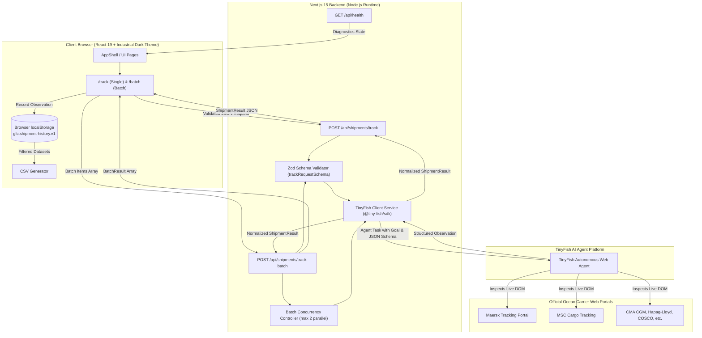

# Navora — Global Freight Command Center

[](https://nextjs.org/)
[](https://react.dev/)
[](https://www.typescriptlang.org/)
[](https://tailwindcss.com/)
[](https://tinyfish.ai)
[](https://vitest.dev/)

**Navora** (Global Freight Command Center) is a shipment intelligence and freight visibility dashboard built for logistics coordinators, supply chain operators, and freight forwarders.

Powered by **Next.js 15 App Router** and **TinyFish Web AI Agents**, Navora queries live, official carrier tracking portals (such as Maersk, MSC, Hapag-Lloyd, CMA CGM, and COSCO) on-demand, extracting structured milestones, events, container coordinates, and estimated arrival times—**without relying on fragile scrapers, fake mock data, or insecure client-side credentials**.

---

## Table of Contents

- [Key Value Propositions](#key-value-propositions)
- [System Architecture](#system-architecture)
- [How It Works (Data Flow)](#how-it-works-data-flow)
- [Project Directory Structure](#project-directory-structure)
- [Detailed File & Component Explanations](#detailed-file--component-explanations)
- [Core Features](#core-features)
- [Carrier Registry & Status](#carrier-registry--status)
- [API Contract & Specifications](#api-contract--specifications)
- [Quick Start Guide](#quick-start-guide)
  - [1. Prerequisites](#1-prerequisites)
  - [2. Clone or Initialize Repository](#2-clone-or-initialize-repository)
  - [3. Install Dependencies](#3-install-dependencies)
  - [4. Configure Environment Variables](#4-configure-environment-variables)
  - [5. Run Development Server](#5-run-development-server)
  - [6. GitHub Setup Instructions](#6-github-setup-instructions)
- [Available Scripts](#available-scripts)
- [Design Philosophy & Limitations](#design-philosophy--limitations)
- [Hackathon Documentation Index](#hackathon-documentation-index)

---

## Key Value Propositions

1. **Evidence-Based Ground Truth**:
   The application never fabricates tracking telemetry. If a carrier portal returns `needs_login`, `blocked`, or `not_found`, Navora reports this outcome honestly and preserves the official carrier URL for manual verification.
2. **Server-Side Security**:
   The `TINYFISH_API_KEY` never leaks to the client browser. All agent dispatches are routed through authenticated Next.js Node.js server routes.
3. **Controlled Concurrency**:
   Batch lookups (up to 5 shipments) run with a strict concurrency ceiling (maximum 2 parallel browser agent sessions) to prevent rate limits and upstream saturation.
4. **Explainable Anomaly & Delay Warnings**:
   Conservative heuristics detect explicit carrier exception markers (e.g., `exception`, `rolled`, `disruption`, `held`) and stale past ETAs, alerting operators with clear, actionable context.
5. **Zero External Database Overhead**:
   History and audit snapshots persist locally within browser `localStorage`, supporting instant search, filtering, CSV export, and per-shipment re-checks.

---

## System Architecture



---

## How It Works (Data Flow)

1. **Operator Input**: The user selects a supported carrier (e.g., Maersk or MSC) and enters an authorized container ID or Bill of Lading reference.
2. **Server-Side Validation**: The Next.js API route (`/api/shipments/track`) validates the request structure and character bounds using Zod (`src/lib/validation.ts`).
3. **Agent Task Dispatch**: `lookupShipmentWithTinyFish` constructs an explicit, boundary-constrained prompt instructed to:
   - Navigate to the verified carrier URL (`input.carrier.trackingUrl`).
   - Query the specific reference without attempting CAPTCHA bypass or unauthorized logins.
   - Return structured JSON matching the defined `outputSchema`.
4. **Normalization & Warning Calculation**: The server processes the raw agent response, cleans empty/filler strings (`N/A`, `Unknown`, `Unavailable`), extracts milestones, verifies source domain integrity, and generates rule-based alerts (`buildWarnings`).
5. **Client Presentation & Storage**: The frontend updates the UI status badge, milestone timeline, and warnings, while updating local `localStorage` history for dashboard statistics and CSV export.

---

## Project Directory Structure

```text
global-freight-command-center/
├── .env.example                # Sample environment configuration template
├── .gitignore                  # Git ignore rules (protects credentials and builds)
├── next.config.ts              # Next.js 15 application configuration
├── package.json                # Project dependencies, scripts, and package metadata
├── postcss.config.mjs          # PostCSS configuration for Tailwind CSS
├── tailwind.config.ts          # Tailwind CSS design system tokens and styling
├── tsconfig.json               # TypeScript strict compiler configuration
├── vitest.config.ts            # Vitest unit test runner configuration
├── eslint.config.mjs           # ESLint flat config with Next.js presets
│
├── src/                        # Application source code
│   ├── app/                    # Next.js App Router (pages & server API endpoints)
│   │   ├── layout.tsx          # Root HTML layout with font configuration & AppShell
│   │   ├── page.tsx            # Root redirector (redirects '/' to '/dashboard')
│   │   ├── globals.css         # Custom Industrial-Dark design system & animations
│   │   ├── dashboard/          # Operations overview desk with real-time KPI metrics
│   │   │   └── page.tsx        # Dashboard page component
│   │   ├── track/              # Single shipment live lookup interface
│   │   │   └── page.tsx        # Track page component
│   │   ├── batch/              # Multi-shipment batch queue lookup interface
│   │   │   └── page.tsx        # Batch tracking page component
│   │   ├── history/            # Per-browser tracking observation audit history
│   │   │   └── page.tsx        # History page component (with search & filter)
│   │   ├── carriers/           # Verified ocean carrier directory & direct portals
│   │   │   └── page.tsx        # Carrier directory page component
│   │   ├── settings/           # System diagnostics, key health, and storage controls
│   │   │   └── page.tsx        # Settings page component
│   │   └── api/                # Node.js backend routes (protected from browser)
│   │       ├── health/         # System and API key health verification
│   │       │   └── route.ts    # GET /api/health
│   │       └── shipments/
│   │           ├── track/      # Single live carrier lookup endpoint
│   │           │   └── route.ts# POST /api/shipments/track
│   │           └── track-batch/# Concurrent-limited batch lookup endpoint
│   │               └── route.ts# POST /api/shipments/track-batch
│   │
│   ├── components/             # Reusable UI component library
│   │   ├── AppShell.tsx        # Navigation sidebar, breadcrumb topbar, and frame
│   │   ├── TrackForm.tsx       # Live tracking lookup form with loading states
│   │   ├── ShipmentTable.tsx   # Detailed results table with expandable milestones
│   │   ├── StatCard.tsx        # Industrial KPI metric card with color tones
│   │   └── StatusBadge.tsx     # Visual indicator for carrier & lookup statuses
│   │
│   └── lib/                    # Core business logic, utilities, and integrations
│       ├── types.ts            # Shared TypeScript data models, contracts, and enums
│       ├── carriers.ts         # Carrier registry, URLs, and priority classifications
│       ├── validation.ts       # Zod schemas for tracking and batch validation
│       ├── storage.ts          # Browser localStorage persistence & CSV export
│       ├── format.ts           # Date/time formatting and string presentation helpers
│       ├── useShipmentHistory.ts# Custom React hook for synchronized history state
│       └── tinyfish/
│           └── client.ts       # TinyFish agent runner, JSON extraction & heuristics
│
├── tests/                      # Automated test suites
│   └── validation.test.ts      # Unit tests for carrier registry and Zod schemas
│
└── docs/                       # Hackathon guides & specifications
    ├── API_CONTRACT.md         # Detailed API input/output specification
    ├── CARRIER_TEST_CHECKLIST.md # Live verification checklist for shipping carriers
    ├── CONTRIBUTING.md         # Team branching, review, and merging workflow
    ├── DEMO_SCRIPT.md          # 90-second hackathon presentation walkthrough
    ├── HACKATHON_QUICKSTART.md # Rapid onboarding guide for teammates
    └── TEAM_SPLIT.md           # Role division across frontend, backend, and QA
```

---

## Detailed File & Component Explanations

### Application Pages (`src/app/`)

- [`layout.tsx`](./src/app/layout.tsx): Defines the root layout structure, imports Inter fonts, establishes dark metadata, and wraps all views inside the responsive `AppShell`.
- [`page.tsx`](./src/app/page.tsx): Direct route redirector from root `/` to `/dashboard`.
- [`dashboard/page.tsx`](./src/app/dashboard/page.tsx): Main operations control deck. Computes total lookups, success rates, active alerts, and unique carriers directly from real local history. Features a quick-lookup card and recent activities table.
- [`track/page.tsx`](./src/app/track/page.tsx): Dedicated single-shipment tracking studio with step-by-step guidance, source verification notices, and deep investigation results.
- [`batch/page.tsx`](./src/app/batch/page.tsx): Batch processing suite allowing up to 5 concurrent references across multiple carriers, featuring status progress bars and batch CSV export.
- [`history/page.tsx`](./src/app/history/page.tsx): Comprehensive audit log with full-text search, carrier dropdown filtering, status filtering, per-item refresh, deletion, and RFC-compliant CSV download.
- [`carriers/page.tsx`](./src/app/carriers/page.tsx): Directory of 10 global carriers with priority badges, testing status notes, reference hints, and direct outbound links to official tracking portals.
- [`settings/page.tsx`](./src/app/settings/page.tsx): Diagnostic control center displaying runtime environment status, TinyFish API key availability, local storage record counts, and storage purge utilities.

### Backend API Routes (`src/app/api/`)

- [`health/route.ts`](./src/app/api/health/route.ts): Exposes `GET /api/health`. Checks server uptime and confirms whether `TINYFISH_API_KEY` is loaded into environment variables.
- [`shipments/track/route.ts`](./src/app/api/shipments/track/route.ts): Exposes `POST /api/shipments/track`. Validates inputs via Zod, looks up carrier configs, executes the TinyFish agent, and returns a standardized `ShipmentResult`.
- [`shipments/track-batch/route.ts`](./src/app/api/shipments/track-batch/route.ts): Exposes `POST /api/shipments/track-batch`. Validates up to 5 items and runs a worker pool limited to maximum 2 concurrent agent tasks to avoid rate limits and timeouts.

### Core Libraries (`src/lib/`)

- [`types.ts`](./src/lib/types.ts): Canonical definitions for `CarrierId`, `CarrierConfig`, `LookupStatus`, `ShipmentMilestone`, `ShipmentResult`, and API interfaces.
- [`carriers.ts`](./src/lib/carriers.ts): Registry of global container shipping lines (Maersk, MSC, CMA CGM, Hapag-Lloyd, COSCO, Evergreen, ONE, OOCL, ZIM, Yang Ming).
- [`validation.ts`](./src/lib/validation.ts): Zod schemas (`trackRequestSchema`, `batchRequestSchema`) enforcing tracking number regex (`^[A-Za-z0-9][A-Za-z0-9 .\/_-]*$`) and length boundaries (3–80 characters).
- [`tinyfish/client.ts`](./src/lib/tinyfish/client.ts): Orchestrates `@tiny-fish/sdk`. Defines the output schema, constructs prompts, handles upstream errors, parses JSON payload variations, verifies official domain URLs, and runs the conservative warning engine.
- [`storage.ts`](./src/lib/storage.ts): Browser `localStorage` adapter (`gfc.shipment-history.v1`) with error handling and client-side CSV generator.
- [`useShipmentHistory.ts`](./src/lib/useShipmentHistory.ts): React state hook providing persistent history, real-time addition, selective deletion, and storage synchronization across views.

### UI Components (`src/components/`)

- [`AppShell.tsx`](./src/components/AppShell.tsx): Industrial layout shell with sidebar navigation, active page indicator, workspace pill, breadcrumbs, live lookup indicator, and mobile menu scrim.
- [`TrackForm.tsx`](./src/components/TrackForm.tsx): Intuitive tracking submission form with carrier selector, sample placeholder updates, input validation messages, and live loading spinners.
- [`ShipmentTable.tsx`](./src/components/ShipmentTable.tsx): Rich data grid displaying carrier, tracking reference, status, latest event, location, ETA, retrieval timestamp, warnings, and expandable milestone timelines.
- [`StatCard.tsx`](./src/components/StatCard.tsx): Metric summary card with icons and customizable tones (`green`, `amber`, `red`, `neutral`).
- [`StatusBadge.tsx`](./src/components/StatusBadge.tsx): Standardized pill badges for tracking outcomes (`success`, `needs_login`, `blocked`, `not_found`, `error`).

---

## Core Features

| Feature | Description |
| :--- | :--- |
| **Real-Time Web Intelligence** | Employs TinyFish AI browser agents to inspect real carrier websites on-demand. |
| **Single & Batch Tracking** | Lookup individual containers or process batches of up to 5 shipments with throttled concurrency. |
| **Audit-Ready Snapshots** | Saves each observation with exact ISO retrieval timestamps and direct official carrier links. |
| **Conservative Warning Engine** | Flags carrier exceptions (held, rolled, delayed) and expired ETAs without false alarms. |
| **Zero-Database Persistence** | Stores up to 200 recent lookups inside browser `localStorage` with full offline availability. |
| **RFC-Compliant CSV Export** | Export filtered or complete tracking history snapshots with a single click. |
| **Carrier Directory** | Instant reference guide for tracking URL patterns and reference formats for top carriers. |
| **Industrial Dark UI** | Precision high-contrast UI styled with Tailwind CSS, custom gradients, and Lucide icons. |

---

## Carrier Registry & Status

| Carrier | Code | Integration Status | Tracking URL | Reference Format |
| :--- | :--- | :--- | :--- | :--- |
| **Maersk** | `maersk` | **Priority** | [maersk.com/tracking](https://www.maersk.com/tracking/) | Container / B/L number |
| **MSC** | `msc` | **Priority** | [msc.com/track-a-shipment](https://www.msc.com/en/track-a-shipment) | Container / Booking / B/L |
| **CMA CGM** | `cma-cgm` | Candidate | [cma-cgm.com/ebusiness/tracking](https://www.cma-cgm.com/ebusiness/tracking) | Container / Reference |
| **Hapag-Lloyd** | `hapag-lloyd` | Candidate | [hapag-lloyd.com/solutions/tracking](https://www.hapag-lloyd.com/solutions/tracking/) | Container / B/L number |
| **COSCO** | `cosco` | Candidate | [elines.coscoshipping.com](https://elines.coscoshipping.com/ebusiness/cargoTracking) | Container / Booking / B/L |
| **Evergreen** | `evergreen` | Candidate | [shipmentlink.com](https://www.shipmentlink.com/servlet/TDB1_CargoTracking.do) | Container / Shipment Ref |
| **ONE** | `one` | Candidate | [ecomm.one-line.com](https://ecomm.one-line.com/ecom/CUP_HOM_3301.do) | Container / B/L Ref |
| **OOCL** | `oocl` | Candidate | [oocl.com/ourservices](https://www.oocl.com/eng/ourservices/eservices/cargotracking/Pages/default.aspx) | Container / B/L Ref |
| **ZIM** | `zim` | Candidate | [zim.com/tools/track-a-shipment](https://www.zim.com/tools/track-a-shipment) | Container / Shipment Ref |
| **Yang Ming** | `yang-ming` | Candidate | [yangming.com/e-service](https://www.yangming.com/e-service/track_trace/track_trace_cargo_tracking.aspx) | Container / B/L Ref |

> **Lookup Outcome Classifications:**
> - `success`: Carrier page loaded and active shipment details were successfully extracted.
> - `not_found`: Carrier verified that no matching shipment exists for the provided reference.
> - `needs_login`: Carrier page requires customer authentication or an active portal account.
> - `blocked`: Carrier portal served an anti-bot restriction or CAPTCHA (reported transparently).
> - `unsupported`: Carrier portal layout is incompatible with automated public extraction.
> - `error`: Network, timeout, or upstream agent execution failure.

---

## API Contract & Specifications

### 1. Health Diagnostic

```http
GET /api/health
```

**Response (200 OK):**
```json
{
  "ok": true,
  "service": "global-freight-command-center",
  "tinyfishConfigured": true,
  "checkedAt": "2026-10-29T17:15:00.000Z",
  "note": "Key presence is checked only. A real agent run is required to verify upstream access."
}
```

### 2. Single Shipment Tracking

```http
POST /api/shipments/track
Content-Type: application/json

{
  "carrier": "maersk",
  "trackingNumber": "MSKU1234567"
}
```

**Response (200 OK):**
```json
{
  "success": true,
  "result": {
    "id": "3fa85f64-5717-4562-b3fc-2c963f66afa6",
    "carrier": "maersk",
    "carrierName": "Maersk",
    "trackingNumber": "MSKU1234567",
    "lookupStatus": "success",
    "status": "In Transit",
    "latestEvent": "Vessel departure",
    "location": "Rotterdam, Netherlands",
    "eventDate": "2026-10-28 14:30 UTC",
    "estimatedArrival": "2026-11-04",
    "origin": "Rotterdam",
    "destination": "New York",
    "lastFreeDate": null,
    "milestones": [
      {
        "description": "Gate in cy",
        "location": "Rotterdam",
        "eventDate": "2026-10-26 09:12 UTC"
      },
      {
        "description": "Loaded on vessel",
        "location": "Rotterdam",
        "eventDate": "2026-10-27 18:40 UTC"
      }
    ],
    "sourceUrl": "https://www.maersk.com/tracking/MSKU1234567",
    "retrievedAt": "2026-10-29T17:15:30.120Z",
    "warnings": []
  }
}
```

### 3. Batch Tracking

```http
POST /api/shipments/track-batch
Content-Type: application/json

{
  "items": [
    { "carrier": "maersk", "trackingNumber": "MSKU1234567" },
    { "carrier": "msc", "trackingNumber": "MEDU9876543" }
  ]
}
```

---

## Quick Start Guide

### 1. Prerequisites

- **Node.js**: v18.0.0 or higher (v20 or v22 LTS recommended)
- **npm**: v9.0.0 or higher
- **TinyFish API Key**: Obtain from [agent.tinyfish.ai/api-keys](https://agent.tinyfish.ai/api-keys)
- **Git**: Installed and configured on your workstation

### 2. Clone or Initialize Repository

If cloning from GitHub:
```bash
git clone https://github.com/Abpattar/Navora.git
cd Navora
```

### 3. Install Dependencies

```bash
npm install
```

### 4. Configure Environment Variables

Copy the example environment configuration:
```bash
cp .env.example .env.local
```

Edit `.env.local` to add your TinyFish API key:
```env
TINYFISH_API_KEY=your_actual_tinyfish_api_key_here
NEXT_PUBLIC_APP_NAME=Navora Freight Command Center
```

> **Note**: `.env.local` is listed in `.gitignore` and must **never** be committed to version control.

### 5. Run Development Server

```bash
npm run dev
```

Navigate to [http://localhost:3000](http://localhost:3000) in your browser. Verify the service and key status at [http://localhost:3000/api/health](http://localhost:3000/api/health).

---

### 6. GitHub Setup Instructions

To link and push this codebase to the repository [https://github.com/Abpattar/Navora.git](https://github.com/Abpattar/Navora.git):

```bash
# 1. Initialize local repository
git init

# 2. Stage all project files (ignoring node_modules and .env.local)
git add .

# 3. Commit the project
git commit -m "feat: complete Navora global freight command center codebase"

# 4. Set default branch to main
git branch -M main

# 5. Link the remote origin
git remote add origin https://github.com/Abpattar/Navora.git

# 6. Push to GitHub
git push -u origin main --force
```

---

## Available Scripts

| Command | Action |
| :--- | :--- |
| `npm run dev` | Starts the Next.js development server at `http://localhost:3000` |
| `npm run build` | Compiles the production application bundle |
| `npm start` | Launches the built production server |
| `npm run typecheck` | Runs TypeScript compiler checks without emitting files (`tsc --noEmit`) |
| `npm run lint` | Runs ESLint across the codebase using Next.js rules |
| `npm test` | Runs the Vitest test suite (`tests/validation.test.ts`) |

---

## Design Philosophy & Limitations

- **No Synthetic Placeholders**: Missing values are rendered as `Unavailable` or omitted. The app never substitutes dummy timelines.
- **No CAPTCHA Bypass**: The browser agent will not attempt to solve security challenges or bypass firewall protections. If blocked, it stops and reports the barrier honestly.
- **Client Key Isolation**: The TinyFish key is never sent to the browser or embedded into static client assets.
- **Stateless Server Architecture**: Tracking history is stored client-side in `localStorage`. There is no backend database requirement, allowing rapid deployment to serverless platforms (e.g. Vercel, Netlify).

---

## Hackathon Documentation Index

For team split guidelines, carrier test procedures, and presentation prep, refer to:
- [HACKATHON_QUICKSTART.md](./HACKATHON_QUICKSTART.md) — 5-minute onboarding sheet for teammates
- [API_CONTRACT.md](./API_CONTRACT.md) — JSON schema and HTTP status specifications
- [CARRIER_TEST_CHECKLIST.md](./CARRIER_TEST_CHECKLIST.md) — Manual verification steps per shipping line
- [DEMO_SCRIPT.md](./DEMO_SCRIPT.md) — 90-second live demonstration script
- [TEAM_SPLIT.md](./TEAM_SPLIT.md) — Responsibility matrix (Backend, Frontend, QA)
- [CONTRIBUTING.md](./CONTRIBUTING.md) — Git workflow and pull request guidelines

---

*Built with precision for the Global Freight Hackathon.*
